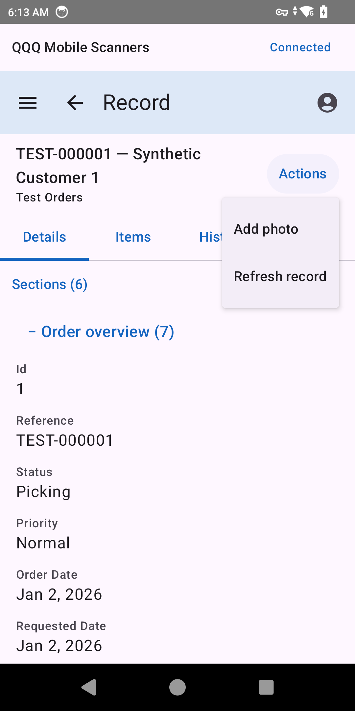
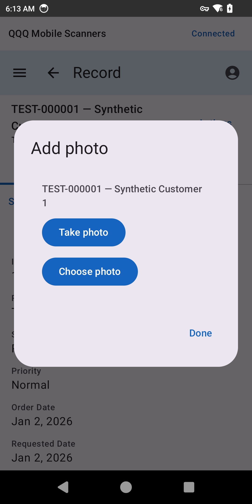
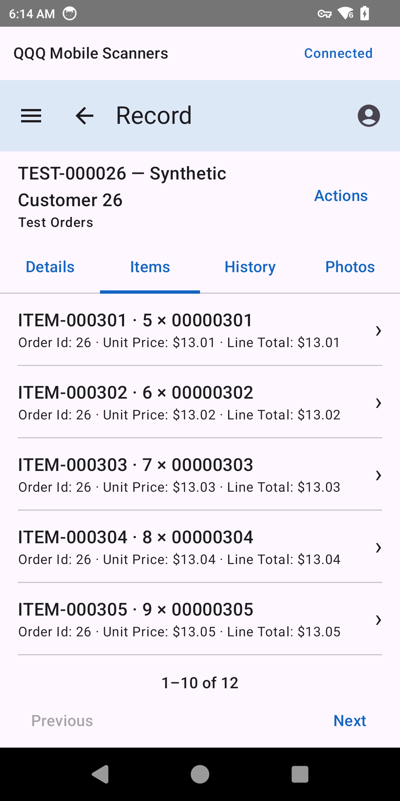
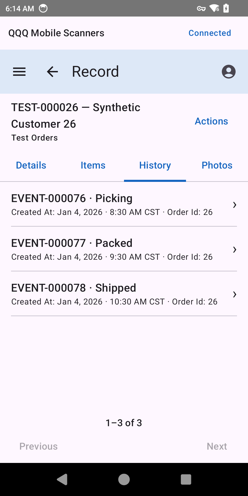
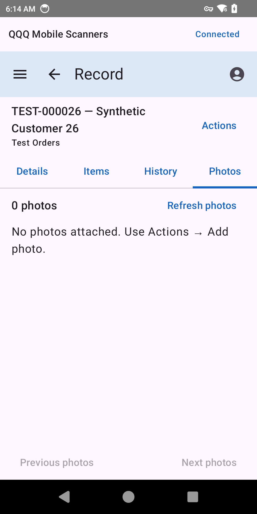
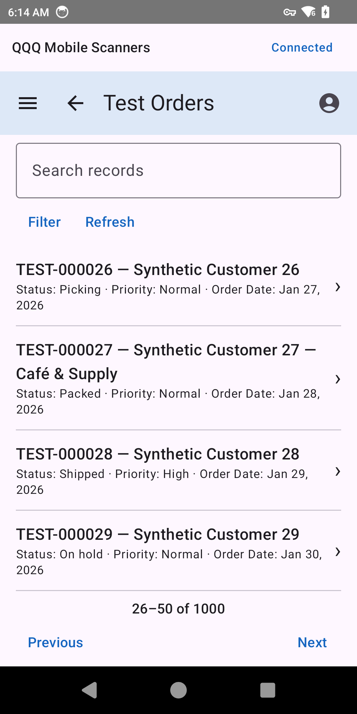

# Record browsing and photo UX — November 5

The existing scanner application now supports permitted tables, grouped record details, related records and record-linked photo capture through standard semantic APIs. The companion Echo demo supplies 1,000 synthetic orders, 12,000 items and 3,000 history entries.

Source review: [Android PR 15](https://git.kof22.com/QRun-IO/qqq-android/pulls/15), paired with [scanner/server PR 19](https://git.kof22.com/QRun-IO/qbit-mobile-scanners/pulls/19).

## User flow

Open **Test Data → Test Orders**, search or filter, and select a record. Back preserves page/search/filter context. A fixed identity heading sits above Details, Items, History and Photos. Groups collapse and can be selected from Sections. Related items show concise reference/quantity/SKU labels; timestamps include timezone context and server currency/units are preserved.

Use **Actions → Add photo → Take photo / Choose photo**. The selected record remains visible in the chooser. Saved attachments appear under Photos with review status. Available images have thumbnails and previews; quarantined originals remain unavailable. Photo transfer remains online-only, idempotent and protected by parent permissions and device/session authorization.

## Verification

- 232 unit tests: core 52, mobileapp 57, host 123; zero failures/errors/skips. Scanner lint: zero errors/warnings. Debug, E2E and instrumentation APK builds passed; eight runner guard tests passed.
- Isolated MC9400 rich-record native acceptance passed paging, groups, related queries/navigation, search/filter/Back preservation, camera/gallery persistence, approved preview, parent-scoped gallery, rotation, pending-photo navigation protection and forced-logout cleanup. All HTTP requests matched the semantic API. Existing process-photo acceptance also passed.
- The final date fallback handles default `%s` metadata and differing raw/display JSON values; its unit/lint/debug-build gate passed. Actual TC22 inspection confirmed localized dates/timezones, currency, Actions/capture chooser, direct tabs and order 26 → Android Back → page two. The full native suite preceded this date-only follow-up.
- Updated the ordinary TC22 app in place with matching signer and installed bytes verified: SHA-256 `F71033C835AC3EB361A04D78C842947C5A04C85CE1AB1B999AA8CEFBFC9D7A95`. No app-data reset, replacement login or separate manual QA app was needed.

Native camera/gallery inputs in automated acceptance were synthetic. This visual pass did not capture an operator photo, print a label or qualify physical GS1 reproduction. The November 4 operator report remains accepted separately.

## Actual TC22 screenshots

All displayed records are synthetic. These are screenshots of the installed app, not mockups.

| Record and actions | Capture chooser |
| --- | --- |
|  |  |

| Related items | Related history |
| --- | --- |
|  |  |

| Saved-photo empty state | Table after Android Back |
| --- | --- |
|  |  |

## Implementation boundaries

Record Files intentionally denies aggregate counts; photo pages use bounded queries with one lookahead row. Downloads use the owner's authenticated tracked-delivery endpoint, exact size/hash verification, same-origin credentials, no redirects, bounded bitmap decoding and no image disk cache. Hidden fields stay out of native summaries/search.

Pending-upload Back handling is registered inside the record destination, after NavHost's callback. Configuration disposal does not clear retained upload guards; authentication teardown does. Tests use a disposable application ID, fresh temporary database and isolated accounts, preserving normal device/demo data.

No new business routes, generic screen framework, offline queue, raw record editing, production signing or artifact publication is introduced. Remaining qualification is tracked in [TODO](TODO.md).
