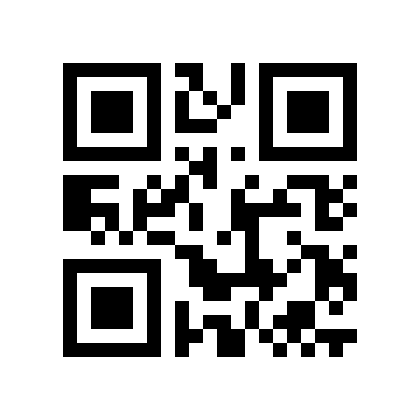

# Hardware test barcode

Open this page on another screen or print the image at its original proportions. Scan it with the handheld's physical trigger while **Scan capture** is ready.

[Open the full-size QR image](test-barcodes/leading-zero-qr.png).

The exact expected value is **`001234567890`**. Preserve it as a raw string, including both leading zeros; do not convert it to a number. This image contains only that test value, with no enrollment URL, device token, or credentials.

Wait for **Saved scan**, then verify the new backend scan record contains the exact value `001234567890`, QR symbology, `zebra-emdk` source, the expected device, and a new event ID. Match its capture time to the trigger pull. Seeing or decoding this image alone does not establish successful hardware capture or storage; record that acceptance separately. A deliberate second trigger pull should produce a distinct event ID.

The 420 × 420 PNG was copied byte-for-byte from the verified local fixture and independently decoded with ZXing 3.5.4 after copying. SHA256: `81ADBEE44E4F3ACA8DE59845151134C433DFD76270A45D42872835F214BC0F8F`.
